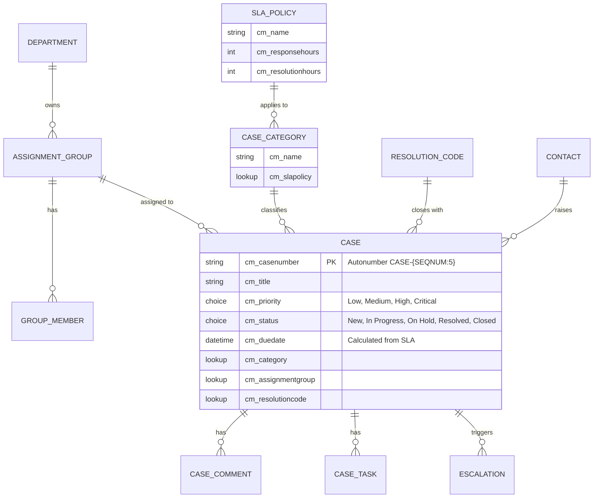

# Dataverse Case Management (Model-driven App)

A model-driven case-tracking app built on a **10-table Dataverse data model** with relationships, business rules and **role-based security**.

> Re-created demo built in a personal developer environment, based on the design approach I used for an enterprise case-tracking app. All names and data are fictional.

## 🗂️ Data Model

| # | Table | Purpose |
|---|---|---|
| 1 | Case (`cm_case`) | Core record |
| 2 | Case Category (`cm_casecategory`) | Classification + SLA link |
| 3 | SLA Policy (`cm_slapolicy`) | Response / resolution targets |
| 4 | Case Comment (`cm_casecomment`) | Timeline notes |
| 5 | Case Task (`cm_casetask`) | Work items under a case |
| 6 | Escalation (`cm_escalation`) | Escalation history |
| 7 | Assignment Group (`cm_assignmentgroup`) | Team queues |
| 8 | Group Member (`cm_groupmember`) | Users in a group |
| 9 | Department (`cm_department`) | Org structure |
| 10 | Resolution Code (`cm_resolutioncode`) | Standardized closure reasons |

Uses the standard **Contact** table for case requesters.

Full column-level design: [`docs/data-model.md`](docs/data-model.md)

## 🔐 Security Roles

| Privilege on Case | Case Agent | Case Manager | Case Admin | Auditor |
|---|---|---|---|---|
| Create | User | Business Unit | Organization | — |
| Read | Business Unit | Business Unit | Organization | Organization |
| Write | User | Business Unit | Organization | — |
| Delete | — | — | Organization | — |
| Assign | User | Business Unit | Organization | — |

Details and rationale: [`docs/security-roles.md`](docs/security-roles.md)

## ⚙️ App Features

- Main form with tabs (Summary, Tasks, Comments, Escalations) and a timeline
- Views: My Open Cases, Group Queue, Overdue Cases, Critical Cases
- Business rules: require Resolution Code when status = Resolved; lock fields once Closed
- Calculated due date from the SLA policy
- Dashboard with case volume by category and status

## 📦 Solution Layout

The unpacked solution goes in `/solution` (exported with `pac solution export` and unpacked with `pac solution unpack`). See the [ALM pipelines repo](https://github.com/pavan-reddy-cheedeti/powerplatform-alm-pipelines) for automation.

## 👤 Author

**Pavan Reddy Cheedeti** — Power Platform Developer · [LinkedIn](https://www.linkedin.com/in/pavan-reddy-ch-a960b7439/)
